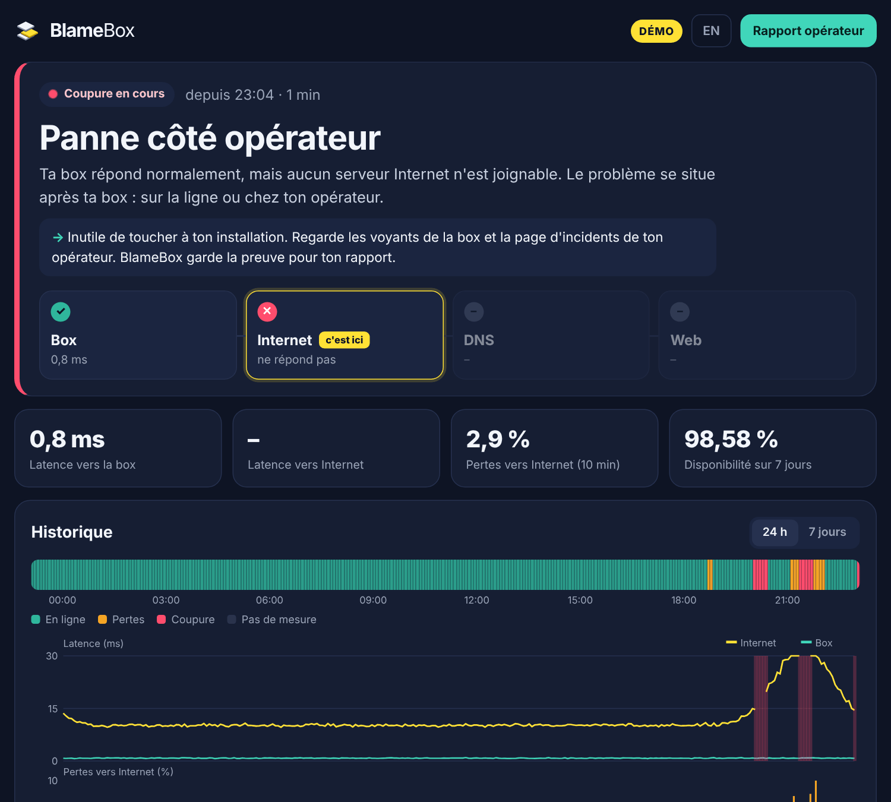

<p align="center"><picture><source media="(prefers-color-scheme: dark)" srcset="docs/logo-dark.png"></picture></p>

<p align="center"><b>Ta connexion coupe ? Sache enfin à qui la faute.</b><br>
Une petite sonde auto-hébergée qui surveille ta connexion couche par couche, explique chaque panne en clair et prépare le rapport pour ton opérateur.</p>

<p align="center"><a href="README.md">🇬🇧 English</a> · <a href="https://blamebox.github.io">Site du projet</a></p>

<p align="center"></p>

> **État : v0.1, bêta.** Ça fonctionne et c'est testé, mais c'est jeune. Tes retours et signalements de bugs sont les bienvenus.

## Pourquoi

Quand la connexion coupe, chacun accuse l'autre : la box, le Wi-Fi, l'opérateur. Le support te demande de redémarrer ta box. Les outils de supervision montrent *que* ça a coupé, pas *où*.

BlameBox répond à une seule question : **quelle couche a lâché, et à qui la faute ?**

## Ce que fait BlameBox

- **Teste ta connexion toutes les 30 s, couche par couche** : la box, deux IP publiques, le DNS (celui de la box et des DNS publics), puis le web.
- **Désigne le coupable en clair** : « Panne côté opérateur : ta box répond normalement, mais aucun serveur Internet n'est joignable. »
- **Ignore les micro-coupures** : une panne n'est déclarée qu'après 3 tests ratés d'affilée (90 s).
- **Mesure les pertes du soir**, vers la box *et* au-delà, pour distinguer une saturation chez l'opérateur d'un mauvais câble chez toi.
- **Garde les preuves** : chaque panne est horodatée, avec la preuve mesurée (par exemple « box joignable pendant 36 des 36 mesures en échec »).
- **Rédige le rapport pour ton opérateur** : imprimable, horodaté, avec un message prêt à envoyer, construit uniquement à partir des mesures.
- **T'alerte** par ntfy, Telegram ou webhook. Les alertes qui ne peuvent pas partir pendant une coupure sont envoyées dès le retour de la ligne.
- **Tourne chez toi, n'envoie rien ailleurs** : pas de compte, pas de cloud, pas de télémétrie.
- **Léger** : un seul fichier d'environ 9 Mo, aucune dépendance. Raspberry Pi, NAS, mini-PC, toute machine Linux.

## Installation (Docker)

BlameBox doit être **branché en câble** sur la box (une sonde en Wi-Fi mesure ton Wi-Fi) et tourner en **réseau hôte**.

```sh
mkdir blamebox && cd blamebox
curl -O https://raw.githubusercontent.com/blamebox/blamebox/main/docker-compose.yml
docker compose up -d
```

Ouvre `http://<adresse-de-la-machine>:8080`.

Pour essayer sans attendre une vraie panne : mets `BLAMEBOX_DEMO: "1"` dans `docker-compose.yml`, ou lance `blamebox -demo`. La démo simule une semaine avec saturation le soir et coupures, plus une panne en direct toutes les 20 minutes.

### Sans Docker (Raspberry Pi OS, Debian, Ubuntu…)

Télécharge le fichier adapté dans les [versions publiées](https://github.com/blamebox/blamebox/releases) (`linux-arm64` pour un Raspberry Pi 4 ou 5 en 64 bits, `linux-armv7` pour les plus anciens, `linux-amd64` pour un PC), puis :

```sh
sudo install -m 755 blamebox-linux-arm64 /usr/local/bin/blamebox
blamebox -check            # une mesure complète, affichée dans le terminal
```

Pour le faire tourner en permanence, utilise le service systemd fourni dans [`deploy/blamebox.service`](deploy/blamebox.service).

## Réglages

Tout est facultatif. Les réglages se font par variables d'environnement : la liste complète est dans le [README anglais](README.md#configuration). Les plus utiles :

| Variable | Rôle |
|---|---|
| `TZ` | Ton fuseau horaire, par exemple `Europe/Paris` |
| `BLAMEBOX_LANG` | `fr` ou `en`, pour les alertes et le rapport |
| `BLAMEBOX_ISP`, `BLAMEBOX_LINE` | Affichés sur le rapport (par exemple `Orange`, `Fibre`) |
| `BLAMEBOX_NTFY_URL` | Alertes par [ntfy](https://ntfy.sh) |
| `BLAMEBOX_TELEGRAM_TOKEN` + `BLAMEBOX_TELEGRAM_CHAT` | Alertes par Telegram |
| `BLAMEBOX_AUTH` | `utilisateur:motdepasse` pour protéger le tableau de bord |
| `BLAMEBOX_RETENTION_DAYS` | Durée de conservation des mesures (7 jours par défaut) |

## Le rapport pour ton opérateur

Clique sur **Rapport opérateur** : une page à imprimer ou à enregistrer en PDF depuis ton navigateur, avec les coupures, leur preuve mesurée, les pertes du soir et un message prêt à envoyer. Il ne dit que ce qui a été mesuré : si la box ne répondait pas pendant une coupure, le rapport ne prétend pas le contraire.

> Le rapport fera partie d'une version **Pro** payante. Il est **gratuit pendant la bêta**.

## En cas de souci

- **« Ta box ne répond pas » alors que tout marche** : certaines box ignorent les pings. Si Internet répond, BlameBox le voit et affiche seulement un avertissement. Sinon, règle `BLAMEBOX_GATEWAY`.
- **Le DNS de la box échoue toujours** : certaines box ne font pas serveur DNS. En mode `auto`, BlameBox arrête de le tester au bout de 5 minutes ; tu peux aussi régler `BLAMEBOX_DNS_LOCAL=off`.
- **« Le ping ICMP n'est pas autorisé »** : BlameBox passe par TCP, moins précis. Lance-le en root, dans Docker (par défaut) ou avec la capacité `CAP_NET_RAW`.
- **Docker Desktop sur macOS ou Windows** : le réseau hôte n'y fonctionne pas comme sous Linux, la box ne peut pas être mesurée correctement. Utilise une machine Linux (un Raspberry Pi est parfait).

## Licence

[MIT](LICENSE).
