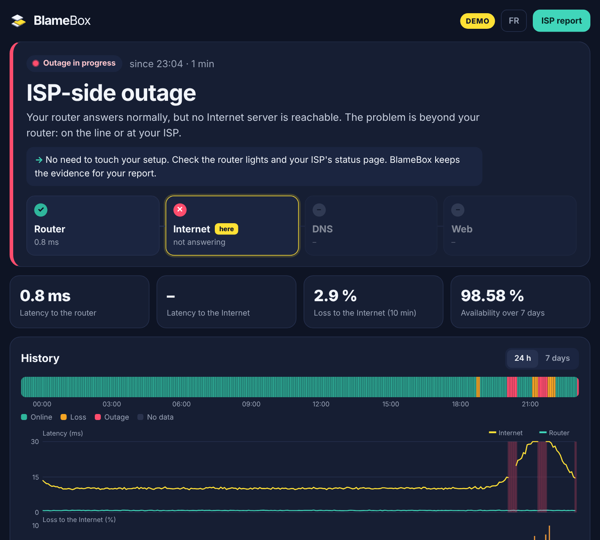

<p align="center"><picture><source media="(prefers-color-scheme: dark)" srcset="docs/logo-dark.png"></picture></p>

<p align="center"><b>Your Internet keeps dropping? Find out who's to blame.</b><br>
A small self-hosted probe that watches your connection layer by layer, explains every outage in plain words, and writes the report for your ISP.</p>

<p align="center"><a href="README.fr.md">🇫🇷 Lire en français</a> · <a href="https://blamebox.github.io">Website</a></p>

<p align="center"></p>

> **Status: v0.1, early beta.** It works and is tested, but it is young. Feedback and bug reports are very welcome.

## Why

When the connection drops, everyone blames someone else: the router, the Wi-Fi, the ISP, "the Internet". Support asks you to restart your router. Graphs from monitoring tools show *that* it failed, not *where*.

BlameBox answers one question: **which layer failed, and whose fault is it?**

## What it does

- **Tests your connection every 30 s, layer by layer**: the router, two public IPs, DNS (your router's and public ones), then the web.
- **Names the culprit in plain words**: "ISP-side outage: your router answers normally, but no Internet server is reachable."
- **Ignores blips**: an outage is only declared after 3 failed checks in a row (90 s).
- **Measures evening packet loss**, to the router *and* beyond it, to tell congestion at the ISP from a bad cable at home.
- **Keeps the evidence**: every outage is time-stamped, with the measured proof (e.g. "router reachable during 36 of 36 failed checks").
- **Writes the ISP report**: a printable, time-stamped report with a pre-written message, built only from measured facts.
- **Alerts you** through ntfy, Telegram or a webhook. Alerts that cannot leave the house during an outage are queued and sent as soon as the line is back.
- **Runs at home, sends nothing anywhere**: no account, no cloud, no telemetry. Data stays in a folder on your machine.
- **Tiny**: one ~9 MB static binary, no dependency, a few MB of RAM. Raspberry Pi, NAS, mini-PC, any Linux box.

## How it finds the fault

| Step | What is tested | If it fails |
|---|---|---|
| 1. Router | ping to your default gateway | **Home side**: router off or frozen, cable unplugged |
| 2. Internet | ping to 1.1.1.1 and 9.9.9.9 (plus DNS/web as fallback evidence) | **ISP side**: the line or the ISP network |
| 3. DNS | a lookup through your router's resolver and through public resolvers | **ISP DNS outage** if only your router's resolver fails (with the workaround) |
| 4. Web | an HTTPS request, names resolved through public DNS | **Web unreachable**: captive portal, filtering, partial outage |

The first step that fails explains the outage. Packet loss is judged on a rolling 10-minute window, separately to the router and to the Internet.

## Quick start (Docker)

BlameBox must be **wired** to your router (a probe on Wi-Fi measures your Wi-Fi) and must run with **host networking** (to see the router as the host does).

```sh
mkdir blamebox && cd blamebox
curl -O https://raw.githubusercontent.com/blamebox/blamebox/main/docker-compose.yml
docker compose up -d
```

Open `http://<machine-address>:8080`.

Try it first without waiting for a real outage: set `BLAMEBOX_DEMO: "1"` in `docker-compose.yml`, or run `blamebox -demo`. The demo simulates a week with evening congestion and outages, plus a live outage every 20 minutes.

### Without Docker (Raspberry Pi OS, Debian, Ubuntu…)

Download the binary for your machine from the [releases](https://github.com/blamebox/blamebox/releases) (`linux-arm64` for a Raspberry Pi 4/5 on a 64-bit OS, `linux-armv7` for older ones, `linux-amd64` for a PC), then:

```sh
sudo install -m 755 blamebox-linux-arm64 /usr/local/bin/blamebox
blamebox -check            # one measurement, printed in the terminal
```

To run it permanently, use the systemd unit in [`deploy/blamebox.service`](deploy/blamebox.service).

### From source

```sh
make build && ./blamebox -demo     # Go 1.24+, no other dependency
```

## Configuration

Everything is optional. Set environment variables (in `docker-compose.yml` or the systemd unit):

| Variable | Default | Meaning |
|---|---|---|
| `BLAMEBOX_LISTEN` | `:8080` | Dashboard address |
| `BLAMEBOX_DATA_DIR` | `./data` (`/data` in Docker) | Where measurements are stored |
| `BLAMEBOX_INTERVAL` | `30s` | Time between two checks |
| `BLAMEBOX_LANG` | `fr` | `fr` or `en`, for alerts and the report (the dashboard follows the browser) |
| `BLAMEBOX_RETENTION_DAYS` | `7` | How long raw measurements are kept (incidents are kept forever) |
| `BLAMEBOX_GATEWAY` | auto | Router IP, if detection picks the wrong one |
| `BLAMEBOX_TARGETS` | `1.1.1.1,9.9.9.9` | Public IPs pinged every check |
| `BLAMEBOX_DNS_LOCAL` | `auto` | Your router's resolver: `auto` (the router), an IP, or `off` |
| `BLAMEBOX_DNS_PUBLIC` | `1.1.1.1,9.9.9.9` | Public resolvers |
| `BLAMEBOX_OPEN_AFTER` / `BLAMEBOX_CLOSE_AFTER` | `3` / `2` | Failed / good checks in a row to open / close an outage |
| `BLAMEBOX_LOSS_THRESHOLD` | `5` | Packet loss (%) above which the line is "degraded" |
| `BLAMEBOX_AUTH` | — | `user:password` to protect the dashboard |
| `BLAMEBOX_ISP`, `BLAMEBOX_LINE` | — | Shown on the report (e.g. `Orange`, `Fibre`) |
| `BLAMEBOX_DEMO` | — | `1` for simulated outages |
| `TZ` | — | Your time zone, e.g. `Europe/Paris` |

### Alerts

| Channel | Variables |
|---|---|
| [ntfy](https://ntfy.sh) | `BLAMEBOX_NTFY_URL` (e.g. `https://ntfy.sh/a-long-secret-topic`), optional `BLAMEBOX_NTFY_TOKEN` |
| Telegram | `BLAMEBOX_TELEGRAM_TOKEN` (from @BotFather) and `BLAMEBOX_TELEGRAM_CHAT` |
| Webhook | `BLAMEBOX_WEBHOOK_URL`: receives a JSON `POST` with `title`, `body`, `kind` (`opened`, `closed`, `test`) and the `incident` |

A **Send a test alert** button is in the dashboard, under *How BlameBox measures*.

## The ISP report

Click **ISP report** on the dashboard: a printable page (print it or save it as PDF from your browser) with the outages, their measured proof, the evening packet loss and a pre-written message. It only states what was measured: if the router was not reachable during an outage, the report does not claim it was.

> The report is planned as part of a paid **Pro** version. It is **free during the beta**.

## API

`GET /api/status`, `/api/samples?hours=24`, `/api/incidents?days=30`, `/api/events?days=7`, `/api/export/incidents.csv`, `/healthz`. JSON, read-only.

Prometheus metrics are served on `/metrics` (`blamebox_up`, `blamebox_layer_ok`, `blamebox_rtt_milliseconds`, `blamebox_loss_ratio`, `blamebox_availability_7d_ratio`…).

## Data and privacy

Measurements are JSON Lines files in the data directory, one per day, deleted after the retention period. Nothing is sent anywhere except the probes themselves (pings, DNS lookups and one HTTPS request to Cloudflare per check, which also reveals your public IP to detect changes) and the alerts you configure.

## Troubleshooting

- **"Your router is not answering" while everything works**: some routers ignore pings. If the Internet answers, BlameBox notices and only shows a warning. Otherwise set `BLAMEBOX_GATEWAY`.
- **The router DNS is always failing**: some routers do not run a DNS server. In `auto` mode BlameBox stops testing it after 5 minutes; you can also set `BLAMEBOX_DNS_LOCAL=off`.
- **"ICMP ping is not allowed"**: BlameBox falls back to TCP, which is less precise. Run it as root, in Docker (default), or with `CAP_NET_RAW`.
- **Docker Desktop on macOS or Windows**: host networking does not behave like on Linux, so the router cannot be measured properly. Use a Linux machine (a Raspberry Pi is perfect).
- **Check an installation**: `blamebox -check` prints one full measurement and the verdict.

## Roadmap

- IPv6 checks
- Home Assistant integration (sensors "Internet OK" and "cause")
- Several sites in one dashboard (home, office, parents)
- Report templates per ISP, server-side PDF
- Pro licence for the report and long history

## Licence

[MIT](LICENSE). Contributions welcome: open an issue first for anything big.
